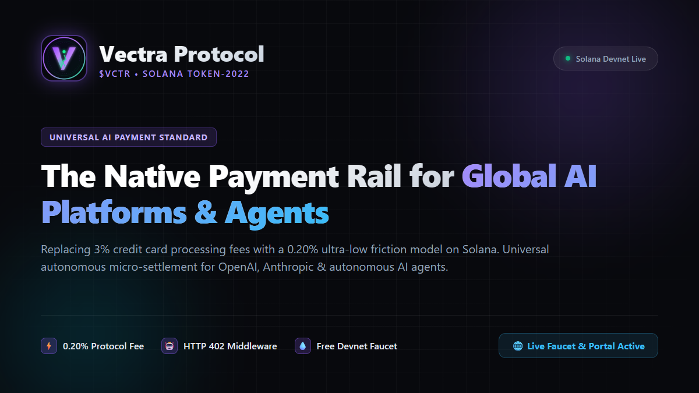

<div align="center">
  

  <h1>Vectra Protocol ($VCTR)</h1>
  <p><strong>The Decentralized Universal Payment Currency & Settlement Protocol for Global AI Platforms & Autonomous Agents</strong></p>

  <p>
    <b>English</b> | <a href="./README_CN.md">简体中文</a>
  </p>

  <p>
    <a href="https://aa971375532.github.io/vectra-protocol/"></a>
    <a href="https://explorer.solana.com/address/79NqWzXcrKsUfwWSv9wP2ZFeLvmRkUPoWyv8fEFxJFh4"></a>
    <a href="https://aa971375532.github.io/vectra-protocol/#faucet"></a>
    <a href="https://x.com/shenmolian4/status/2112949960765481183"></a>
    <a href="https://spl.solana.com/token-2022"></a>
    <a href="https://github.com/solana-foundation/awesome-solana-ai/pull/267"></a>
    <a href="./LICENSE"></a>
  </p>
</div>

---

## 🌟 Executive Summary

**Vectra ($VCTR)** is an ultra-low friction, high-throughput decentralized cryptocurrency architected natively upon the **Solana** blockchain. Standardized on the latest **SPL Token-2022** program, Vectra solves the systemic breakdown of legacy payment rails (Stripe, credit cards) in modern artificial intelligence workloads.

It provides a universal, native payment medium designed to be integrated directly into the official checkout flows of leading AI platforms (such as OpenAI, Claude, Midjourney, and open-source model providers), as well as serving as the native financial standard for **Autonomous AI Agents (Machine-to-Machine commerce)**.

---

## ⚡ Core Value Propositions

- **AI Agent Native (M2M Standard)**: Enables autonomous AI agents—lacking legal identities or banking debit cards—to autonomously transact and procure compute, models, and API tools using native cryptographic keypairs.
- **Zero-Decline Cross-Border Access**: Eliminates geographical card-declines, IP-blocking, and high currency-conversion markups for the 60%+ of developers residing outside North America and Western Europe.
- **0.20% Dual-Track Low-Friction Model**:
  - **Peer-to-Peer & DEX Trading**: **0.00% absolute zero tax** to ensure frictionless capital velocity and deep secondary market liquidity.
  - **AI Merchant Settlement**: Assesses a lightweight **0.20% network fee (0.10% permanently burned to black hole for sustainable micro-deflation, 0.10% into protocol treasury for continuous R&D)**.
- **Gasless User Experience (Native Fee Payer)**: Powered by Solana's native fee-payer mechanism, end users and AI agents require **0 SOL** to execute payments, transacting purely in `$VCTR` with Web2-level latency (<400ms).

---

## 🪙 Tokenomics & On-Chain Fundamentals

| Parameter | Specification |
| :--- | :--- |
| **Token Name** | Vectra |
| **Ticker Symbol** | **$VCTR** |
| **Underlying Blockchain** | Solana (SPL Token-2022 Standard) |
| **Precision (Decimals)** | **9** (Optimized for token-level micro-metering) |
| **Total Supply** | **1,000,000,000 $VCTR (Fixed Hard-Cap, Zero Inflation)** |
| **Merchant Settlement Fee** | **0.20%** (50% Burned, 50% Treasury) |
| **P2P Transfer / DEX Tax** | **0.00%** (Zero friction) |
| **Mainnet Mint Address** | [`79NqWzXcrKsUfwWSv9wP2ZFeLvmRkUPoWyv8fEFxJFh4`](https://explorer.solana.com/address/79NqWzXcrKsUfwWSv9wP2ZFeLvmRkUPoWyv8fEFxJFh4) |
| **Mint Authority** | **Permanently Revoked (null)** 🔒 |
| **Freeze Authority** | **Permanently Revoked (null)** 🔒 |
| **Devnet Mint Address** | `8aGGfyBvgeiq9WbyZRbgYSKkXhnYymNVh7oMw2ju4t14` |

---

## 📂 Repository Architecture

```
vectra-protocol/
├── VECTRA_WHITEPAPER_EN.md   # 🇺🇸 Official English Technical Whitepaper (Full 9 Chapters)
├── VECTRA_WHITEPAPER_CN.md   # 🇨🇳 Official Chinese Technical Whitepaper (Full 9 Chapters)
├── PITCH_DECK.md             # 📊 10-Slide Investor & Partner Presentation Deck
├── README.md                 # 🌐 English Official Repository Overview
├── README_CN.md              # 🇨🇳 Chinese Official Repository Overview
│
├── packages/
│   └── sdk/                  # 💻 Official JavaScript/TypeScript SDK (@vectra/pay-sdk)
├── python-sdk/               # 🐍 Official Python SDK & HTTP 402 Middleware (vectra-pay)
├── examples/
│   └── http402-ai-server.js  # 🤖 Working HTTP 402 Per-Request AI Model Micropayment Server
├── scripts/
│   ├── create-vectra-token.js# Token-2022 Deployment Engine with Transfer-Fee Extension
│   ├── generate-keys.js      # Keypair Provisioning Utility
│   └── view-keys.js          # Credential Display & Explorer Tooling
├── test/
│   └── protocol.test.js      # 🧪 Automated Mathematical & Tokenomic Test Suite
├── public/
│   ├── index.html            # 🌐 Interactive Official Portal & Checkout Preview
│   └── logo.svg              # 🎨 Official Vector Logo Artwork
└── server.js                 # ⚡ Official Local Portal & API Daemon
```

---

## 🚀 Quickstart & Developer Integration

### 1. Run Automated Protocol Math Tests
Verify the 0.20% dual-track mathematical fee split and 9-decimal precision:
```bash
npm test
```

### 2. Start the Interactive Web Portal
Launch the local official portal with checkout simulation and whitepaper viewer:
```bash
npm start
```
Visit **http://localhost:3000** in your browser.

### 3. JavaScript / TypeScript SDK (`@vectra/pay-sdk`)
Integrate into any AI platform web checkout in 2 lines of code:
```javascript
import { VectraCheckout } from '@vectra/pay-sdk';

const checkout = new VectraCheckout({
  merchantAddress: 'DDngT11XyxqbYi38nNv1sDNxw1K4er1WHQb7EyAQhcgg',
  amountVctr: 20.0,
  orderId: 'AI-SUB-20261021',
  onSuccess: (signature) => {
    console.log('Payment verified on Solana:', signature);
  }
});

checkout.render('#vectra-pay-button');
```

### 4. Python SDK & HTTP 402 Middleware (`vectra-pay`)
Monetize any FastAPI / Starlette LLM endpoint per request using native HTTP 402:
```python
from fastapi import FastAPI
from vectra_pay import VectraHTTP402Middleware

app = FastAPI()

# Mount Vectra Decentralized Micropayment Middleware
app.add_middleware(
    VectraHTTP402Middleware,
    merchant_address="DDngT11XyxqbYi38nNv1sDNxw1K4er1WHQb7EyAQhcgg",
    price_per_call=0.05  # Charges 0.05 $VCTR per model inference call
)
```

### 5. Devnet $VCTR Faucet
Request free 500 $VCTR test tokens directly to your Solana wallet to test M2M micro-payments:
```bash
npm run faucet <YOUR_SOLANA_DEVNET_WALLET_ADDRESS>
```

### 6. Mainnet-Beta Deployment & Liquidity Guide
Prepare for Solana Mainnet-Beta deployment and Raydium CPMM liquidity pool setup:
```bash
npm run deploy:mainnet
```
Read the full institutional launch roadmap: **[MAINNET_DEPLOYMENT_GUIDE.md](./MAINNET_DEPLOYMENT_GUIDE.md)**.

### 7. SDK Publishing to npm & PyPI
Guides and automated workflows for package distribution:
- **[SDK_PUBLISHING_GUIDE.md](./SDK_PUBLISHING_GUIDE.md)**
- GitHub Actions Workflow: `.github/workflows/publish-sdk.yml`

---

## 📑 Official Documentation & Whitepapers

- 🇺🇸 **[English Technical Whitepaper (VECTRA_WHITEPAPER_EN.md)](./VECTRA_WHITEPAPER_EN.md)**
- 🇨🇳 **[中文技术白皮书 (VECTRA_WHITEPAPER_CN.md)](./VECTRA_WHITEPAPER_CN.md)**
- 📊 **[Investor Pitch Deck (PITCH_DECK.md)](./PITCH_DECK.md)**
- 🚀 **[Mainnet & Liquidity Pool Guide (MAINNET_DEPLOYMENT_GUIDE.md)](./MAINNET_DEPLOYMENT_GUIDE.md)**
- 📦 **[SDK Publishing Guide (SDK_PUBLISHING_GUIDE.md)](./SDK_PUBLISHING_GUIDE.md)**

---

## 🛡️ License & Contributing

- Distributed under the [MIT License](./LICENSE).
- For contributions, please review [CONTRIBUTING.md](./CONTRIBUTING.md).
- To report security vulnerabilities, consult [SECURITY.md](./SECURITY.md).
