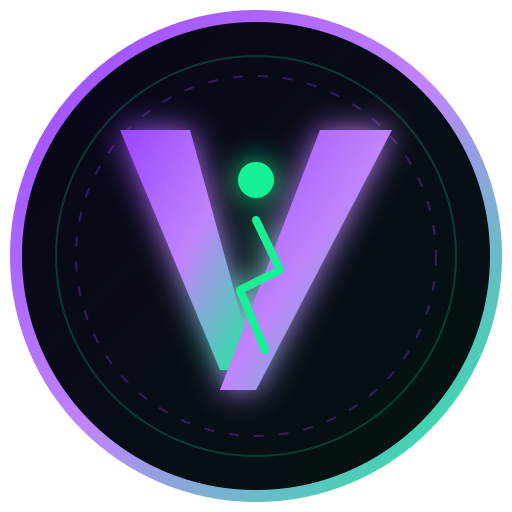

<div align="center">
  
  <h1>Vectra Protocol ($VCTR)</h1>
  <p><strong>全球各大 AI 平台与自主智能体通用的去中心化原生支付协议与结算货币</strong></p>

  <p>
    <a href="./README.md">English</a> | <b>简体中文</b>
  </p>

  <p>
    <a href="https://solana.com"></a>
    <a href="https://spl.solana.com/token-2022"></a>
    <a href="./LICENSE"></a>
    <a href="./test/"></a>
  </p>
</div>

---

## 🌟 项目愿景与概述

**Vectra ($VCTR)** 是一个基于高性能公链 **Solana** 构建的去中心化原生加密货币与通用结算协议。采用最新的 **SPL Token-2022** 标准，Vectra 旨在解决传统法币支付渠道（如 Stripe、双币信用卡）在现代人工智能高频交互场景下的系统性缺陷。

Vectra 致力于直接内嵌进全球主流 AI 平台（如 OpenAI、Claude、Midjourney 及广大开源生态）官方收银台，同时作为 **自主 AI 智能体（Machine-to-Machine 机器间经济）** 的原生数字货币标准。

---

## ⚡ 核心价值主张

- **AI 智能体原生 (Agent Native)**：为无银行卡、无身份 KYC 的自主 AI 智能体提供机器原生加密资产结算。
- **0 拒付全球免外卡 (Zero-Decline Global Access)**：突破非美区 60% 开发者面临的发卡行风控拒付壁垒，实现全球毫秒级结算。
- **0.20% 双轨制低磨损模型**：
  - **点对点转账 / DEX 做市**：**0.00% 绝对零税率**，保护二级市场极致流动性。
  - **AI 平台商户结算**：提取极低 **0.20% 网络费（0.10% 永久黑洞销毁促成微通缩，0.10% 汇入协议金库持续研发）**。
- **原生 Gas 代付体验 (Fee Payer)**：借助 Solana 原生 Fee Payer 机制，终端用户钱包 **0 SOL** 即可支付，体验比肩 Web2（<400ms 确认）。

---

## 🪙 核心代币经济学参数

| 核心参数 | 规格指标 |
| :--- | :--- |
| **代币名称** | Vectra |
| **代币代号** | **$VCTR** |
| **底层公链** | Solana (SPL Token-2022 规范) |
| **代币精度** | **9 位精度** (支持小数点后 9 位超微额 Token 计费) |
| **总发行量** | **1,000,000,000 $VCTR (10 亿枚恒定上限，永不增发)** |
| **商户结算手续费** | **0.20%** (50% 销毁 + 50% 协议金库) |
| **普通转账 / DEX 税率** | **0.00%** (零摩擦流通) |
| **Devnet 官方 Mint 地址** | `8aGGfyBvgeiq9WbyZRbgYSKkXhnYymNVh7oMw2ju4t14` |

---

## 📂 项目工程架构一览

```
vectra-protocol/
├── VECTRA_WHITEPAPER_CN.md   # 🇨🇳 官方中文技术白皮书 (9大章节完整版)
├── VECTRA_WHITEPAPER_EN.md   # 🇺🇸 Official English Technical Whitepaper
├── PITCH_DECK.md             # 📊 10 页投资与合作伙伴路演幻灯片 (Pitch Deck)
├── README.md                 # 🌐 English Official Repository Overview (默认英文)
├── README_CN.md              # 🇨🇳 简体中文官方项目概览
│
├── packages/
│   └── sdk/                  # 💻 官方 JavaScript/TypeScript SDK (@vectra/pay-sdk)
├── python-sdk/               # 🐍 官方 Python SDK & HTTP 402 中间件 (vectra-pay)
├── examples/
│   └── http402-ai-server.js  # 🤖 完整运行的 HTTP 402 AI 模型微支付服务端示例
├── scripts/
│   ├── create-vectra-token.js# Token-2022 部署脚本 (带 0.2% 费率扩展)
│   ├── generate-keys.js      # 创世密钥对生成脚本
│   └── view-keys.js          # 查看 Base58 私钥与链上链接
├── test/
│   └── protocol.test.js      # 🧪 协议核心数学与代币经济学自动化测试套件
├── public/
│   ├── index.html            # 🌐 Vectra 官方交互门户与收银台接入预览前端
│   └── logo.svg              # 🎨 官方矢量 Logo
└── server.js                 # ⚡ 官方本地服务与 API 路由
```

---

## 🚀 极速上手与开发者接入

### 1. 运行核心协议自动化测试
```bash
npm test
```

### 2. 启动官方交互门户
```bash
npm start
```
在浏览器访问 **http://localhost:3000**。

### 3. JavaScript / TypeScript SDK (`@vectra/pay-sdk`)
只需 2 行代码即可在任何 AI 平台收银台挂载支付：
```javascript
import { VectraCheckout } from '@vectra/pay-sdk';

const checkout = new VectraCheckout({
  merchantAddress: 'DDngT11XyxqbYi38nNv1sDNxw1K4er1WHQb7EyAQhcgg',
  amountVctr: 20.0,
  orderId: 'AI-SUB-20261021',
  onSuccess: (signature) => {
    console.log('Solana 链上支付验证成功:', signature);
  }
});

checkout.render('#vectra-pay-button');
```

### 4. Python SDK & HTTP 402 中间件 (`vectra-pay`)
为任何基于 FastAPI 搭建的 AI 大模型推理接口添加按次收取 $VCTR：
```python
from fastapi import FastAPI
from vectra_pay import VectraHTTP402Middleware

app = FastAPI()

# 挂载 Vectra 去中心化 HTTP 402 AI 微支付中间件
app.add_middleware(
    VectraHTTP402Middleware,
    merchant_address="DDngT11XyxqbYi38nNv1sDNxw1K4er1WHQb7EyAQhcgg",
    price_per_call=0.05  # 每次模型调用扣 0.05 $VCTR
)
```

### 5. Devnet $VCTR 测试网水龙头
在终端为指定钱包一键发放 500 $VCTR 测试代币（链上自动扣减 0.20% 磨损）：
```bash
npm run faucet <您的_SOLANA_DEVNET_钱包公钥>
```

### 6. 主网 (Mainnet-Beta) 部署与流动性池搭建
准备部署至 Solana 主网并配置 Raydium CPMM 流动性池：
```bash
npm run deploy:mainnet
```
详见机构级上线指南：**[MAINNET_DEPLOYMENT_GUIDE.md](./MAINNET_DEPLOYMENT_GUIDE.md)**。

### 7. SDK 发布至 npm & PyPI 官方包仓库
- **[SDK 发布全流程操作手册 (SDK_PUBLISHING_GUIDE.md)](./SDK_PUBLISHING_GUIDE.md)**
- GitHub Actions 自动化发布工作流：`.github/workflows/publish-sdk.yml`

---

## 📑 官方文档与白皮书

- 🇨🇳 **[中文技术白皮书 (VECTRA_WHITEPAPER_CN.md)](./VECTRA_WHITEPAPER_CN.md)**
- 🇺🇸 **[English Technical Whitepaper (VECTRA_WHITEPAPER_EN.md)](./VECTRA_WHITEPAPER_EN.md)**
- 📊 **[商业路演幻灯片 (PITCH_DECK.md)](./PITCH_DECK.md)**
- 🚀 **[主网与流动性池搭建指南 (MAINNET_DEPLOYMENT_GUIDE.md)](./MAINNET_DEPLOYMENT_GUIDE.md)**
- 📦 **[SDK 发布指南 (SDK_PUBLISHING_GUIDE.md)](./SDK_PUBLISHING_GUIDE.md)**

---

## 🛡️ 许可证与规范

- 遵循 [MIT 开源许可证](./LICENSE)。
- 欢迎阅读 [贡献规范 (CONTRIBUTING.md)](./CONTRIBUTING.md) 与 [安全漏洞披露政策 (SECURITY.md)](./SECURITY.md)。
