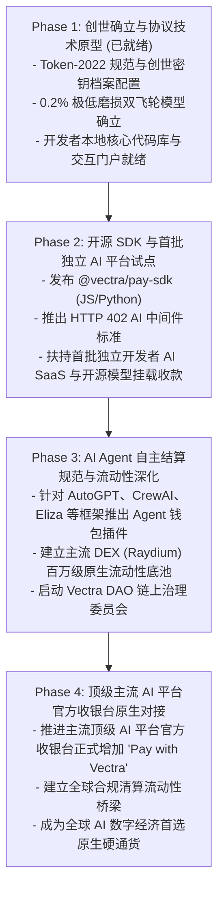

# Vectra ($VCTR) 技术白皮书 (Vectra Whitepaper)

**专为全球 AI 平台与智能体打造的去中心化原生支付协议与结算货币**  
*The Decentralized Native Payment Protocol & Settlement Currency for the Global AI Economy*

版本：v2.0 (正式版)  
发布时间：2026 年 10 月  
网络底层：Solana (Token-2022 扩展协议)  
官网/文档仓库：Vectra Protocol Foundation  

---

## 目录 (Table of Contents)

1. [摘要 (Abstract)](#1-摘要-abstract)
2. [背景与核心痛点 (Background & Problem Statement)](#2-背景与核心痛点-background--problem-statement)
   - 2.1 传统信用卡支付体系在 AI 场景下的系统性崩溃
   - 2.2 跨国支付壁垒与非美区高频拒卡
   - 2.3 自主 AI 智能体（Autonomous Agents）无法持有银行账户
   - 2.4 现有通用加密货币的缺陷
3. [Vectra 架构设计与技术实现 (System Architecture)](#3-vectra-架构设计与技术实现-system-architecture)
   - 3.1 为什么选择 Solana Token-2022？
   - 3.2 0.2% 双轨制低磨损微手续费协议
   - 3.3 HTTP 402 去中心化支付接口标准
   - 3.4 原生 Gas 代付机制 (Fee Payer) 与账户无感体验
4. [代币经济学与货币政策 (Tokenomics & Monetary Policy)](#4-代币经济学与货币政策-tokenomics--monetary-policy)
   - 4.1 核心资产参数
   - 4.2 初始分配与线性释放模型
   - 4.3 低磨损微通缩模型 (Burn & Treasury Engine)
   - 4.4 价值捕获闭环与抗通胀动力学
5. [AI 平台官方接入框架 (AI Platform Integration Framework)](#5-ai-平台官方接入框架-ai-platform-integration-framework)
   - 5.1 官方收银台原生嵌入 (Pay with Vectra SDK)
   - 5.2 即时流动性兑付与防汇率波动机制
   - 5.3 平台端零坏账与反欺诈保障
6. [AI 智能体经济（Machine-to-Machine）原生标准](#6-ai-智能体经济machine-to-machine原生标准)
7. [去中心化治理与安全性 (Governance & Security)](#7-去中心化治理与安全性-governance--security)
   - 7.1 权限永久废弃 (Authority Renouncement)
   - 7.2 协议金库多签管理 (Squads Protocol)
   - 7.3 DAO 链上治理演进路线
8. [项目发展路线图 (Roadmap)](#8-项目发展路线图-roadmap)
9. [法律声明与风险提示 (Legal Disclaimer)](#9-法律声明与风险提示-legal-disclaimer)

---

## 1. 摘要 (Abstract)

随着大语言模型（LLM）和生成式人工智能的指数级普及，全球数字化经济正以惊人的速度从“人与人交互”向“人与 AI 平台”、“AI 智能体与 AI 服务”高频交互迁移。然而，现有的全球金融支付网络（基于 SWIFT、Stripe、Visa/Mastercard 信用卡）建立在几十年前的中心化信用体系之上，无法承载 AI 时代高并发、跨国界、微颗粒度（按 Token 扣费）以及自主机器结算的核心诉求。

**Vectra ($VCTR)** 是一个基于高性能公链 Solana 构建的去中心化原生加密货币与通用结算协议。通过深度集成 Solana Token-2022 规范、HTTP 402 去中心化支付标准以及原生费用代付（Fee Payer）架构，Vectra 旨在成为全球主流 AI 平台（如 OpenAI、Claude、Midjourney 及广大开源生态）官方收银台的原生通用结算货币。

Vectra 创新性地提出了 **“0.2% 极低磨损双轨制微手续费模型”**：对日常钱包转账与二级市场交易维持 **0% 零税率** 以保障极致的货币流动性；仅在 AI 商户端产生真实商业消费时提取 **0.2% 网络费（0.1% 永久黑洞销毁促成健康微通缩，0.1% 汇入协议金库持续赋能研发）**。Vectra 消除中心化金融摩擦，重塑全球 AI 经济的结算底层。

---

## 2. 背景与核心痛点 (Background & Problem Statement)

### 2.1 传统信用卡支付体系在 AI 场景下的系统性崩溃
传统法币支付渠道在 AI 消费场景下面临无法调和的矛盾：
- **微额计费失败**：大模型调用是按 Token 计费的，单次推理交互成本通常在 0.0001 美元至 0.01 美元之间。传统信用卡网络每笔交易征收 **0.30 美元固定费用 + 2.9% 比例费率**。高额的固定成本逼迫各大 AI 平台只能采取“按月预扣（$20/月）”或“最低充值 $5”的粗暴模式，无法做到真正的按量实时消费。
- **高额的商家抽成**：AI 平台承受着沉重的 GPU 硬件折旧与电力成本，而中心化收单机构 3% 左右的通道抽成严重侵蚀了 AI 企业的净利润。

### 2.2 跨国支付壁垒与非美区高频拒卡
- 全球超过 60% 的 AI 开发者与用户分布在非欧美地区。当他们尝试订阅海外顶尖 AI 平台时，频繁面临发卡行风控拦截（Decline）、双币外币卡门槛、IP 风控封号以及强制法币结算汇损问题。中心化金融机构设立的合规围墙，阻碍了全球人工智能红利的平权共享。

### 2.3 自主 AI 智能体（Autonomous Agents）无法持有银行账户
- 人工智能正在从被动对话工具演进为具备自主任务规划能力的 **AI Agent**。这些智能体需要在互联网上自主购买算力、租用知识库、调用外部工具 API。然而，**AI 没有法定身份证件，无法在任何传统银行完成 KYC 开设账户或申请信用卡**。AI 时代亟需一种属于机器的原生加密资产。

### 2.4 现有通用加密货币的缺陷
- **BTC / ETH (Layer 1)**：区块确认时间高达数分钟至十几秒，单笔 Gas 费动辄数美元，无法支撑毫秒级的 AI 交互。
- **USDT / USDC**：中心化稳定币受发行机构中心化冻结黑名单控制，且合约缺乏针对 AI 微支付分流的自动化扩展能力。
- **投机型代币**：以往部分项目设定的 2%~5% 极高转账税，破坏了货币的流通属性，导致“大家只炒不花”，无法沉淀真实支付共识。

---

## 3. Vectra 架构设计与技术实现 (System Architecture)

```
+-------------------------------------------------------------------------+
|                         Vectra Protocol Layer                           |
+-------------------------------------------------------------------------+
   |                             |                           |
   v                             v                           v
[Token-2022 规范]          [HTTP 402 去中心化协议]      [原生 Fee Payer 代付]
- 0.2% 商户转账费扩展        - 链上微支付状态通道         - 用户钱包 0 SOL 门槛
- 9 位高精度 (按 Token 计)  - 亚秒级结算确认 (<400ms)    - 纯 $VCTR 结算全流程
- 铸币/冻结权彻底废弃        - 跨平台通用支付签名        - 达到 Web2 级流畅度
```

### 3.1 为什么选择 Solana Token-2022？
Vectra 选用 Solana 作为底层结算账本，利用其 400 毫秒出块时间、极高并发（>3,000 TPS）与低于 0.0005 美元的交易成本。Vectra 全面拥抱最新的 **SPL Token-2022** 扩展程序：
1. **TransferFeeConfig 扩展**：直接在代币底层字节码中强制嵌入费率规则，无需第三方复杂智能合约介入，确保每一笔商户结算均能免信任、原子化地完成分流。
2. **9 位高精度（Decimals = 9）**：1 $VCTR 可细分为 $10^9$ 个微单位，完美契合大模型超细颗粒度 Token 计费。

### 3.2 0.2% 双轨制低磨损微手续费协议
为彻底解决“通缩币破坏流动性”的历史难题，Vectra 确立了严格的**双轨制（Dual-Track Mechanism）**：
- **第一轨：自由流通轨（0% 费率）**
  - 普通用户之间的点对点转账、钱包地址迁移、去中心化交易所（如 Raydium/Orca）的做市与交易，**享受 0.00% 绝对零税率**。
  - 彻底解放二级市场流动性，做市商无需担心滑点与套利磨损，大资金进出自由。
- **第二轨：商户消费轨（0.2% 微费率）**
  - 仅当用户在接入 Vectra 协议的 AI 平台官方收银台产生真实结算时，协议触发 0.2%（20 个基点）的微量网络服务费。
  - **0.10%** 自动打入链上不可逆黑洞地址永久销毁。
  - **0.10%** 汇入协议去中心化金库，用于生态长效建设。

### 3.3 HTTP 402 去中心化支付接口标准
Vectra 将互联网底层雪藏的 `HTTP 402 Payment Required` 标准链上化：
- 客户端请求受保护的 AI API 资源 $\rightarrow$ 服务端返回 `402` 及 Vectra 接收地址与金额 $\rightarrow$ 客户端/智能体毫秒级完成链上签名 $\rightarrow$ 服务端即时校验广播并返回推理流数据。

### 3.4 原生 Gas 代付机制 (Fee Payer) 与账户无感体验
借助 Solana 的原生 `feePayer` 特性，Vectra 允许商户或中继网络代付微量 SOL 手续费：
- 终端用户与 AI Agent 的钱包中**无需预先持有 SOL**，仅凭账户内的 `$VCTR` 即可完成全部支付交互，达到与传统 Web2 支付无异的丝滑体验。

---

## 4. 代币经济学与货币政策 (Tokenomics & Monetary Policy)

### 4.1 核心资产参数

| 属性 | 规格参数 |
| :--- | :--- |
| **代币全称 (Token Name)** | Vectra |
| **代币代码 (Ticker)** | **$VCTR** |
| **底层区块链** | Solana |
| **合约标准** | SPL Token-2022 (with Transfer Fee Extension) |
| **代币精度 (Decimals)** | **9** |
| **总供应量 (Total Supply)** | **1,000,000,000 $VCTR (10 亿枚恒定上限，永不增发)** |
| **铸币权状态** | 部署后永久废弃 (Renounced, Immutable) |

### 4.2 初始分配与线性释放模型

```
1,000,000,000 $VCTR 总供应量分布：
├── 45% (4.5 亿枚) : 全球 AI 算力与开发者生态激励池 (线性释放)
├── 25% (2.5 亿枚) : 去中心化流动性底池 (DEX LP，永久锁仓)
├── 15% (1.5 亿枚) : 核心团队与长期研发储备 (锁仓 1 年，24 个月平滑线性释放)
└── 15% (1.5 亿枚) : 早期社区贡献、合作 AI 平台资助与空投基金 (Grants)
```

1. **生态与算力激励池 (45%)**：专门用于激励早期接入 Vectra 结算的中小 AI 平台、开源大模型节点以及高频调用 Vectra 的活跃智能体。
2. **流动性池 (25%)**：在主网上线时与 SOL / USDC 配对注入 Raydium 等主流 DEX，并将 LP 凭证打入黑洞，确立不可篡改的初始二级市场深度。
3. **创始团队与核心研发 (15%)**：受链上智能合约时间锁（Timelock）约束，上线第一年内完全锁仓，随后分 24 个月按月线性归属，向社区展示长期奉献的决心。
4. **社区与平台接入资助 (15%)**：用于向首批对接 Vectra 官方收银台的独立 AI 平台发放生态 Grant，补贴前期的研发与集成成本。

### 4.3 低磨损微通缩模型 (Burn & Treasury Engine)

每一次真实商户结算中提取的 0.2% 手续费，其流向完全公开透明且由代码锁定：

$$Total\_Fee = Amount \times 0.002$$
$$Burn\_Amount = Total\_Fee \times 0.50 = Amount \times 0.001$$
$$Treasury\_Amount = Total\_Fee \times 0.50 = Amount \times 0.001$$

- **健康通缩动力学**：以全球每年数百亿美元的 AI 消费体量推算，持续沉淀的 0.1% 永久销毁将以平缓、健康、不可逆的趋势缩减全网流通盘。
- **无须牺牲流动性**：极度克制的通缩率避免了流通惩罚，使持币者不仅乐于长期持有，更敢于在日常消费中高频花费。

---

## 5. AI 平台官方接入框架 (AI Platform Integration Framework)

Vectra 致力于让任何 AI 平台以极低的技术成本，在其官网收银台官方挂载 **“Pay with Vectra”**：

### 5.1 官方收银台原生嵌入 (Pay with Vectra SDK)
官方提供适配 Web、React、Node.js 与 Python 的轻量客户端 SDK，仅需数行代码即可在现有结算页完成集成：

```javascript
import { VectraCheckout } from '@vectra/pay-sdk';

const checkout = new VectraCheckout({
  merchantAddress: 'DDngT11XyxqbYi38nNv1sDNxw1K4er1WHQb7EyAQhcgg',
  amountVctr: 20.0,
  orderId: 'ORD-AI-20261021',
  onSuccess: (signature) => {
    // 链上毫秒级确认，AI 平台后端即刻为用户激活会员权益
    grantUserMembership(signature);
  }
});

checkout.render('#vectra-pay-button');
```

### 5.2 即时流动性兑付与防汇率波动机制
对于部分财务核算要求严格以美元法币结算的大型 AI 平台，Vectra 协议层整合了去中心化流动性路由器（如 Jupiter DEX 聚合接口）：
- **用户端**：完全支付 `$VCTR` 代币；
- **商户端结算选择**：AI 平台可选择保留 `$VCTR` 享受生态成长红利，或选择由协议在链上完成原子级即时兑换，以 **100% USDC 稳定币**形式入账。AI 平台承担 **0 汇率波动风险**。

### 5.3 平台端零坏账与反欺诈保障
- 传统信用卡支付中，AI SaaS 饱受盗刷信用卡（Card Testing）及恶意退款（Chargeback）困扰，平台常面临 Stripe 账户冻结与高额罚款。
- **Vectra 交易基于密码学非对称签名，一旦出块即具备数学确定性不可逆性，彻底为 AI 平台消灭欺诈坏账。**

---

## 6. AI 智能体经济（Machine-to-Machine）原生标准

未来数年，AI 智能体调用 AI 平台的资金流水将远超人类个人消费。Vectra 针对 Agent 经济提供专属规范：
- **微型冷钱包集成**：Agent 可内嵌轻量级 Solana 密钥对；
- **智能预授权额度（Allowance Cap）**：Agent 主人可在链上智能合约设定“每小时最高允许自主消费 5 $VCTR”，防止智能体遭遇死循环调用造成资产损失；
- **机器间跨平台协同结算**：负责编写代码的 Agent A，可以用 Vectra 实时雇佣负责安全审计的 Agent B，完成自主闭环协同。

---

## 7. 去中心化治理与安全性 (Governance & Security)

### 7.1 权限永久废弃 (Authority Renouncement)
在 Solana Devnet 与主网完成创世 10 亿枚代币铸造后，**Vectra 的 Mint Authority（铸币权）和 Freeze Authority（冻结权）将被永久禁用并打入废弃指令**。代码即法律，全网没有任何人（包括创始人）能够超发代币或冻结任何用户的合法资产。

### 7.2 协议金库多签管理 (Squads Protocol)
协议金库（用于接收 0.1% 留存收益及团队锁仓资产）采用 Solana 上最高安全等级的 **Squads 多签体系** 管理。任何资金流动与参数调整必须经由多方独立私钥协同签名，杜绝单点私钥风险。

### 7.3 DAO 链上治理演进路线
项目成熟后，核心治理权将全面过渡为由全体 `$VCTR` 持币者组成的 **Vectra DAO**。重大网络决议（如生态 Grant 审批、跨链拓展方案）完全通过链上提案与投票决定。

---

## 8. 项目发展路线图 (Roadmap)



---

## 9. 法律声明与风险提示 (Legal Disclaimer)

1. **技术协议性质**：本白皮书仅用于技术架构、经济模型与开发远景的技术展示，不构成任何形式的证券要约、金融招揽或投资建议。
2. **监管适应性**：Vectra 协议作为去中心化开源软件运行，各接入方应根据所在司法辖区的法律合规要求使用本协议。
3. **技术与市场风险**：区块链底层网络与人工智能技术均处于前沿高速演进中，参与者应充分认知智能合约安全审计、网络拥堵以及数字资产生态波动的固有风险。

---
*© 2026 Vectra Protocol Foundation. 遵循 MIT 开源许可协议。*
