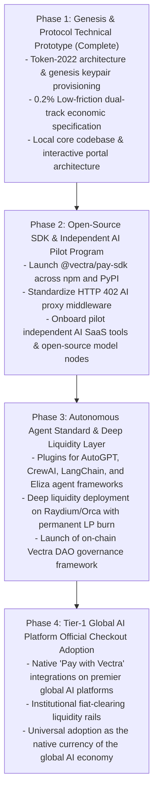

# Vectra ($VCTR) Technical Whitepaper

**The Decentralized Native Payment Protocol & Settlement Currency for the Global AI Economy**

Version: v2.0 (Official Release)  
Date: October 2026  
Underlying Blockchain: Solana (SPL Token-2022 Standard)  
Repository & Foundation: Vectra Protocol Foundation  

---

## Table of Contents

1. [Abstract](#1-abstract)
2. [Background & Industry Problem Statement](#2-background--industry-problem-statement)
   - 2.1 The Breakdown of Legacy Credit Card Rails in AI Workloads
   - 2.2 Global Payment Friction & High Decline Rates for Non-US/EU Users
   - 2.3 The AI Agent Economic Dilemma: Autonomous Machines Cannot Hold Bank Accounts
   - 2.4 The Shortcomings of Existing Cryptocurrencies
3. [Vectra System Architecture & Technical Specifications](#3-vectra-system-architecture--technical-specifications)
   - 3.1 Why Solana Token-2022?
   - 3.2 The 0.2% Dual-Track Low-Friction Micro-Fee Protocol
   - 3.3 HTTP 402 "Payment Required" Decentralized Standard
   - 3.4 Native Gas Sponsorship (Fee Payer) & Frictionless User Experience
4. [Tokenomics & Monetary Policy](#4-tokenomics--monetary-policy)
   - 4.1 Asset Fundamentals
   - 4.2 Initial Distribution & Linear Vesting Schedule
   - 4.3 Low-Friction Micro-Deflation Engine (Burn & Treasury Split)
   - 4.4 Value Accretion & Deflationary Equilibrium
5. [AI Platform Official Integration Framework](#5-ai-platform-official-integration-framework)
   - 5.1 Native Checkout Embeddings (Pay with Vectra SDK)
   - 5.2 Instant Liquidity Routing & Zero Volatility Settlement Options
   - 5.3 Anti-Fraud, Chargeback Immunity & Settlement Finality
6. [Autonomous AI Agent Economy (Machine-to-Machine Standard)](#6-autonomous-ai-agent-economy-machine-to-machine-standard)
7. [Decentralized Governance & Cryptographic Security](#7-decentralized-governance--cryptographic-security)
   - 7.1 Permanent Authority Renouncement
   - 7.2 Protocol Treasury Management (Squads Multisig)
   - 7.3 Progressive Decentralization toward Vectra DAO
8. [Project Roadmap](#8-project-roadmap)
9. [Legal Disclaimer](#9-legal-disclaimer)

---

## 1. Abstract

As Large Language Models (LLMs) and generative artificial intelligence achieve planetary scale, digital commerce is undergoing an irreversible structural transition—migrating from legacy human-to-human transactions toward high-frequency interactions between humans and AI platforms, as well as autonomous machine-to-machine (M2M) communications. However, contemporary global settlement infrastructure—predicated upon SWIFT, centralized merchant aggregators (e.g., Stripe), and credit card schemes (Visa/Mastercard)—was conceived decades ago for coarse-grained human billing. It is fundamentally incapable of supporting sub-cent micro-metering (per-token deduction), sub-second execution, cross-border permissionless access, or sovereign machine-level commerce.

**Vectra ($VCTR)** is a decentralized, high-throughput cryptocurrency and settlement protocol architected natively upon the **Solana** blockchain. Leveraging the **SPL Token-2022** standard, decentralized **HTTP 402** payment interfaces, and native **Fee Payer (Gas Sponsorship)** capabilities, Vectra establishes the universal payment rail intended to be embedded natively into the official checkouts of leading AI platforms (including OpenAI, Claude, Midjourney, and the broader open-source ecosystem).

Vectra introduces a revolutionary **0.2% Dual-Track Low-Friction Fee Model**: Peer-to-peer wallet transfers and secondary market DEX trades remain completely untaxed (**0.00% tax**) to preserve maximal liquidity and zero friction for market makers. Only upon verifiable commercial settlement at an integrated AI merchant checkout is a lightweight **0.2% network fee** assessed: **0.10% is routed to an unrecoverable burn address for continuous, organic deflation, while 0.10% feeds the protocol treasury to sustainably fund ongoing infrastructure**. Vectra eliminates centralized financial rent-seeking and establishes the economic foundation for the autonomous AI economy.

---

## 2. Background & Industry Problem Statement

### 2.1 The Breakdown of Legacy Credit Card Rails in AI Workloads
Traditional payment rails suffer severe architectural failure when subjected to modern AI workloads:
- **Micropayment Infeasibility**: LLM inference is priced at atomic granularities—frequently between \$0.0001 and \$0.01 per prompt/completion transaction. Centralized credit card processors assess a baseline fee of **\$0.30 fixed + 2.9% variable** per charge. This prohibitive overhead forces AI enterprises into rigid, coercive monetization schemes—such as forced recurring \$20/month subscriptions or minimum \$5 credits pre-funding—preventing genuine pay-as-you-go micro-consumption.
- **Aggressive Merchant Margin Erosion**: AI enterprises shoulder immense capital expenditures in GPU depreciation, high-bandwidth interconnects, and gigawatt power grids. Centralized merchant processors extracting 3% to 5% off top-line gross revenues directly jeopardize sustainable infrastructure expansion.

### 2.2 Global Payment Friction & High Decline Rates for Non-US/EU Users
Over 60% of global AI developers, researchers, and power users reside outside North America and Western Europe. When attempting to fund accounts or purchase subscriptions on tier-1 AI services, these users confront endemic issuer-side card declines, severe currency conversion markups, and arbitrary algorithmic account suspensions driven by legacy fraud heuristics. Centralized banking monopolies arbitrarily segregate global access to frontier intelligence.

### 2.3 The AI Agent Economic Dilemma: Autonomous Machines Cannot Hold Bank Accounts
Software development is pivoting toward **Autonomous AI Agents** capable of recursive reasoning, autonomous planning, and dynamic tool orchestration. These agents must autonomously acquire compute, execute web scraping, procure specialized knowledge graphs, and query third-party APIs. Crucially: **An AI Agent possesses no legal identity, cannot satisfy KYC (Know Your Customer) regulations, and cannot be issued a banking debit or credit card.** The emerging autonomous economy requires a natively programmatic, cryptographic store of value.

### 2.4 The Shortcomings of Existing Cryptocurrencies
- **Bitcoin & Ethereum Layer-1**: Block confirmation times ranging from 12 seconds to 10 minutes, coupled with gas fees regularly exceeding multiple dollars, render them unusable for real-time AI API streaming.
- **Centralized Stablecoins (USDT/USDC)**: Subject to arbitrary centralized blacklisting mechanisms and lack token-level native programmable fee redistribution hooks required for automated network deflation.
- **Speculative Hyper-Tax Tokens**: Historical "burn tokens" implementing 5% to 10% transfer penalties paralyzed economic velocity, degrading tokens into speculative instruments rather than real mediums of exchange.

---

## 3. Vectra System Architecture & Technical Specifications

```
+-------------------------------------------------------------------------+
|                         Vectra Protocol Layer                           |
+-------------------------------------------------------------------------+
   |                             |                           |
   v                             v                           v
[Token-2022 Extensions]    [HTTP 402 Middleware]       [Native Fee Payer Rails]
- 0.2% Transfer Fee Config - On-chain state channels   - Zero-SOL user footprint
- 9-Decimal Micro-units    - Sub-400ms finality        - 100% pure $VCTR UX
- Revoked Authorities      - Universal API signatures  - Parity with Web2 latency
```

### 3.1 Why Solana Token-2022?
Vectra anchors its state transitions on the Solana blockchain, capitalizing on 400ms slot times, 3,000+ real-world TPS, and sub-\$0.0005 transaction fees. Vectra standardizes on **SPL Token-2022**:
1. **TransferFeeConfig Extension**: Enforces the 0.2% fee split directly within the bytecode of the token program at the consensus layer, removing the need for intermediary wrapping contracts or custodial escrow single-points-of-failure.
2. **9 Decimals of Precision**: 1 $VCTR divides into $10^9$ sub-units, providing flawless mathematical precision for sub-cent, token-level inference accounting.

### 3.2 The 0.2% Dual-Track Low-Friction Micro-Fee Protocol
To definitively resolve the historic paradox wherein deflationary burn mechanics impair circulating velocity, Vectra institutes a mathematical **Dual-Track Mechanism**:
- **Track 1: Free Circulation (0.00% Tax)**
  - Normal peer-to-peer wallet transfers, treasury rebalancing, and secondary market liquidity provisioning on automated market makers (e.g., Raydium, Orca) incur **zero protocol fees (0.00%)**.
  - Market makers, arbitrageurs, and institutional liquidity providers interact without slippage penalties or capital erosion.
- **Track 2: Merchant Settlement (0.20% Protocol Fee)**
  - Activated exclusively during authenticated commercial checkouts at integrated AI platforms.
  - **0.10%** is programmatically redirected to an irreversible black hole address (`11111111111111111111111111111111`), permanently retiring supply.
  - **0.10%** is routed into the multi-signature protocol treasury to finance infrastructure maintenance, developer grants, and ecosystem expansion.

### 3.3 HTTP 402 "Payment Required" Decentralized Standard
Vectra breathes life into the dormant IETF `HTTP 402 Payment Required` standard:
- Client initiates inference request $\rightarrow$ Server responds with `402 Payment Required` detailing the target Vectra address, nonce, and price $\rightarrow$ Client/Agent cryptographically signs an on-chain transaction $\rightarrow$ Server verifies transaction receipt on Solana within 400ms $\rightarrow$ Streaming response unblocks instantaneously.

### 3.4 Native Gas Sponsorship (Fee Payer) & Frictionless User Experience
Utilizing Solana's native `feePayer` architecture:
- End users and AI Agents **do not need to hold native SOL** in their balance to pay gas. The merchant relayer or platform backend sponsors the fractions-of-a-cent SOL gas cost while deducting the net amount in `$VCTR`, delivering full parity with Web2 consumer expectations.

---

## 4. Tokenomics & Monetary Policy

### 4.1 Asset Fundamentals

| Property | Value / Specification |
| :--- | :--- |
| **Token Name** | Vectra |
| **Ticker Symbol** | **$VCTR** |
| **Blockchain** | Solana |
| **Token Standard** | SPL Token-2022 (with Transfer Fee Extension) |
| **Decimals** | **9** |
| **Total Supply** | **1,000,000,000 $VCTR (Fixed Hard-Cap, Zero Inflation)** |
| **Minting Authority** | Permanently Revoked (Disabled at Genesis) |
| **Freeze Authority** | Permanently Revoked (Disabled at Genesis) |

### 4.2 Initial Distribution & Linear Vesting Schedule

```
1,000,000,000 $VCTR Total Supply Distribution:
├── 45% (450M $VCTR) : Global AI Compute & Developer Ecosystem Incentive Pool
├── 25% (250M $VCTR) : Decentralized Liquidity Pool (DEX LP, Permanently Locked)
├── 15% (150M $VCTR) : Core Team & Long-Term Engineering Reserves (1-Yr Cliff, 24-Mo Linear Vesting)
└── 15% (150M $VCTR) : Early Ecosystem Grants, AI Merchant Adoption & Community Airdrop
```

1. **AI Ecosystem & Developer Pool (45%)**: Deployed across multi-year milestones to subsidize compute providers, open-source model maintainers, and developer tooling integrations.
2. **Decentralized Liquidity Pool (25%)**: Paired with SOL and USDC upon mainnet launch across premier DEXs; LP tokens burned permanently to establish sovereign, unruggable trading depth.
3. **Core Team & Contributors (15%)**: Programmatically time-locked for 12 months post-genesis, followed by a continuous 24-month linear vesting release governed by immutable smart contracts.
4. **Adoption Grants & Platform Integration (15%)**: Directed toward providing non-dilutive engineering grants to third-party AI SaaS platforms embedding the Vectra checkout SDK.

### 4.3 Low-Friction Micro-Deflation Engine (Burn & Treasury Split)

During commercial merchant settlement, fee distribution executes deterministically:

$$Total\_Fee = Amount \times 0.002$$
$$Burn\_Amount = Total\_Fee \times 0.50 = Amount \times 0.001$$
$$Treasury\_Amount = Total\_Fee \times 0.50 = Amount \times 0.001$$

- **Sustainable Deflationary Pressure**: As billions of dollars in global AI inferencing and subscription flows transition across the Vectra settlement rail, the continuous 0.10% burn executes relentless, irreversible reduction in circulating supply.
- **Liquidity Preservation**: The ultra-conservative 0.20% overall rate ensures token holders are never discouraged from spending, preserving velocity while compounding long-term holder equity.

---

## 5. AI Platform Official Integration Framework

Vectra equips enterprise AI platforms with institutional-grade developer tooling designed for seamless integration into production web checkouts:

### 5.1 Native Checkout Embeddings (Pay with Vectra SDK)
Available across modern frontend and backend runtimes (JavaScript/TypeScript, Python, Go):

```javascript
import { VectraCheckout } from '@vectra/pay-sdk';

const checkout = new VectraCheckout({
  merchantAddress: 'DDngT11XyxqbYi38nNv1sDNxw1K4er1WHQb7EyAQhcgg',
  amountVctr: 20.0,
  orderId: 'ORD-AI-20261021',
  onSuccess: (signature) => {
    // Solana confirms in <400ms; backend activates subscription privileges immediately
    grantUserAccess(signature);
  }
});

checkout.render('#vectra-pay-button');
```

### 5.2 Instant Liquidity Routing & Zero Volatility Settlement Options
For major enterprise AI platforms mandated to report financial accounts strictly in fiat USD:
- **Consumer Perspective**: 100% payment settled in `$VCTR`.
- **Merchant Perspective**: The Vectra SDK interfaces with on-chain liquidity routing layers (e.g., Jupiter Aggregator), allowing the merchant to toggle **Instant Conversion to USDC**. The enterprise receives zero-volatility stablecoins directly in their corporate treasury with **0% foreign exchange volatility risk**.

### 5.3 Anti-Fraud, Chargeback Immunity & Settlement Finality
- Legacy AI SaaS companies suffer persistent fraud from stolen credit cards (card-testing bots) and illegitimate chargebacks, regularly risking merchant account termination by Stripe.
- **Vectra transactions are cryptographically signed and achieve irreversible finality within sub-second block confirmation times, definitively eliminating chargebacks and fraud overhead.**

---

## 6. Autonomous AI Agent Economy (Machine-to-Machine Standard)

Over the next decade, autonomous agent-to-agent transactions will surpass human retail consumption by orders of magnitude. Vectra implements the native financial layer for autonomous intelligence:
- **Embedded Machine Keypairs**: Lightweight agent architectures can securely store Solana ed25519 keypairs in secure enclaves.
- **Algorithmic Allowance Caps**: Human operators can configure immutable on-chain spending bounds (e.g., "Maximum 5 $VCTR per hour"), protecting agent owners against recursive execution loops or prompt-injection drainage.
- **Autonomous Micro-Contracting**: A coding agent (Agent A) can contract a security audit agent (Agent B) and disburse micro-payments per line of code validated, executing closed-loop autonomous value transfer.

---

## 7. Decentralized Governance & Cryptographic Security

### 7.1 Permanent Authority Renouncement
Upon completing the initial genesis minting of 1,000,000,000 $VCTR, the protocol's **Mint Authority** and **Freeze Authority** are permanently disabled on-chain. Code is law: no individual, entity, or state can generate supplemental tokens or freeze legitimate user balances.

### 7.2 Protocol Treasury Management (Squads Multisig)
The Vectra protocol treasury is secured by **Squads Protocol**, the gold-standard formal multi-signature framework on Solana. Any deployment of ecosystem reserves requires cryptographic consensus from multiple independent signers across disparate jurisdictions.

### 7.3 Progressive Decentralization toward Vectra DAO
As developer and merchant adoption scales, governance authority over the protocol's developer grant programs and parameter adjustments will fully transition to the **Vectra DAO**, driven by transparent on-chain proposal and quorum mechanics.

---

## 8. Project Roadmap



---

## 9. Legal Disclaimer

1. **Technical Protocol Nature**: This whitepaper is presented solely for educational, technical, and informational purposes regarding open-source software architecture. It does not constitute a prospectus, an offer of securities, an invitation to invest, or financial advice.
2. **Jurisdictional Compliance**: The Vectra protocol operates as decentralized, permissionless software. All parties integrating or transacting with the protocol are responsible for ensuring compliance with applicable laws within their respective jurisdictions.
3. **Inherent Technological Risks**: Blockchain networks and artificial intelligence systems are rapidly evolving technologies. Participants must acknowledge the risks associated with smart contract interactions, cryptographic consensus volatility, and market dynamics.

---
*© 2026 Vectra Protocol Foundation. Released under the MIT Open Source License.*
